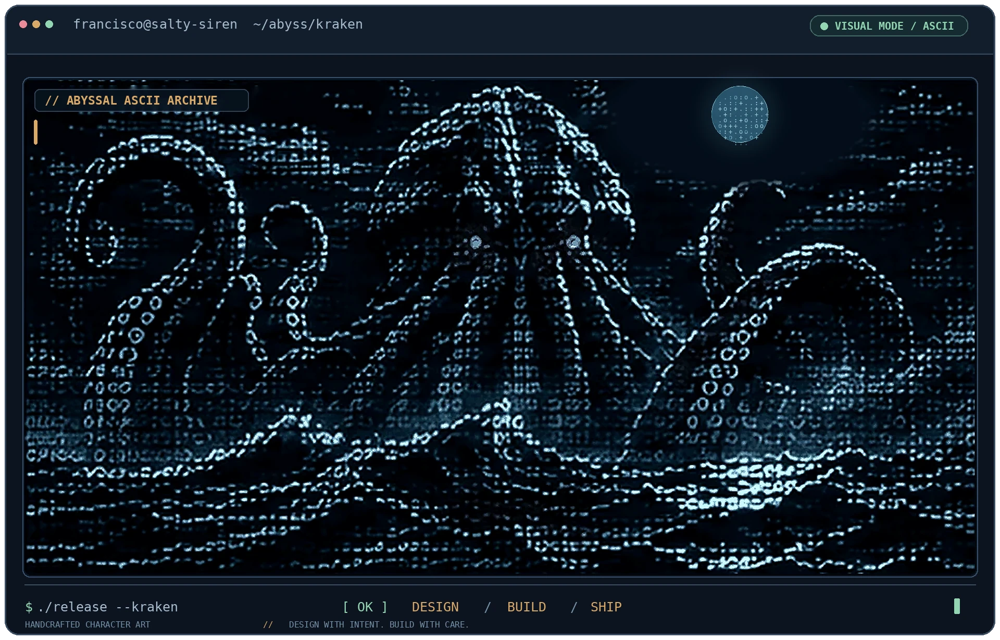
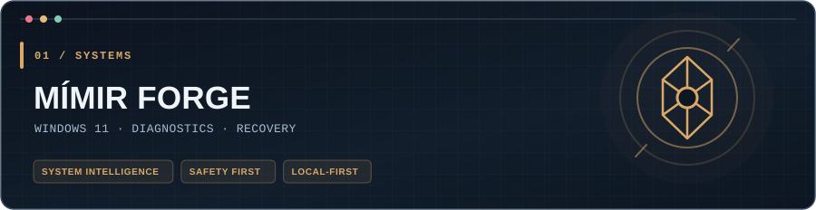
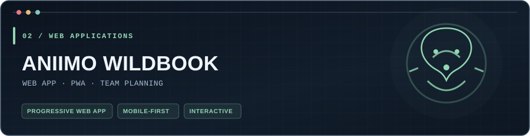
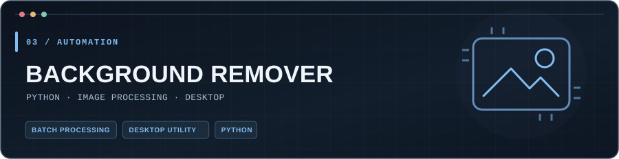
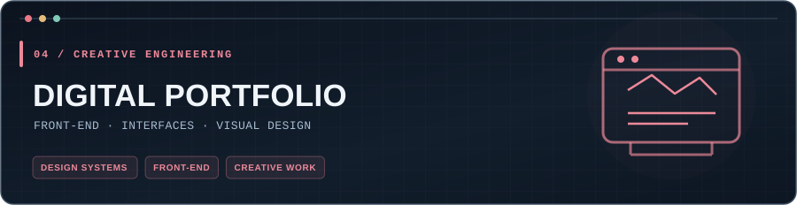

 

**Engineering practical tools. Designing memorable experiences. Automating the rest.**

**[Featured work](#featured-work) · [Toolbox](#the-toolbox) · [Field notes](#field-notes)**

---

### Behind the terminal

I'm **Francisco Carreiro** — a full-stack developer and digital creator working at the intersection of **software, systems, automation, and design**.

I enjoy the whole process: solving the problem nobody sees, then refining the details everybody feels. Whether it's a web app, a desktop utility, or a self-hosted workflow, I aim to build things that are **useful, understandable, and dependable**.

**My playground:** full-stack applications · Windows & Linux tooling · local-first ideas · AI-assisted workflows · UI/UX

<strong>🧭 The builder's compass</strong> — a few principles I work by

- **Clarity over cleverness.** The best solution is one a future maintainer can understand.
- **Automation with guardrails.** Safe defaults, visible outcomes, and a way back.
- **Design is part of engineering.** The small interactions matter as much as the architecture.
- **Stay curious.** Experiment, document what works, and keep improving.

### 🐙 Release the Kraken

  

My little corner of the abyss: a self-hosted, animated ASCII-inspired terminal with a nautical soul.

### Featured work

A selection of public projects spanning system tools, web applications, Python utilities and digital design.

**MÍMIR FORGE** — A portable Windows 11 toolkit bringing diagnostics, security inspection, guided repairs and individually approved system preferences into one interface. Designed around visibility, reversibility and user control.

[Repository](https://github.com/francisco-carreiro/mimir-forge) · [Releases](https://github.com/francisco-carreiro/mimir-forge/releases)

**Aniimo Wildbook** — An independent, installable PWA for exploring creature forms, planning teams and builds, and tracking a personal collection. Built with a mobile-first experience in mind.

[Live app](https://aniimo-center.netlify.app/) · [Repository](https://github.com/francisco-carreiro/aniimo-center)

**Background Remover** — A Python desktop utility for AI-assisted background removal, batch image processing, previews and optional watermarking.

[Repository](https://github.com/francisco-carreiro/background-remover)

**Digital Portfolio** — My public front-end portfolio project, alongside my current personal site showcasing development and creative work.

[Current portfolio](https://fc-digital-architect.netlify.app/) · [Public repository](https://github.com/francisco-carreiro/portfolio)

These are personal and independent projects. Other open-source projects I explore or fork are available under the Repositories tab.

### The toolbox

Technologies I use to build, automate, and refine projects across different environments.

**Web & application development**

**Tools, systems & delivery**

**Design & creative work**

### Field notes

Not every useful idea needs a full repository. I keep smaller experiments, reusable snippets, and practical notes in my **[public GitHub Gists](https://gist.github.com/francisco-carreiro)**.

### Beyond the code

Music, visual art, games, and nature keep my curiosity running. They're a reminder that good software should feel as thoughtful as it is technical.

---

**Have a project in mind or want to connect?**

[Portfolio](https://fc-digital-architect.netlify.app/) · [LinkedIn](https://www.linkedin.com/in/francisco-carreiro/) · [GitHub projects](https://github.com/francisco-carreiro?tab=repositories)

Build with intention · Keep the details sharp · Always keep learning

