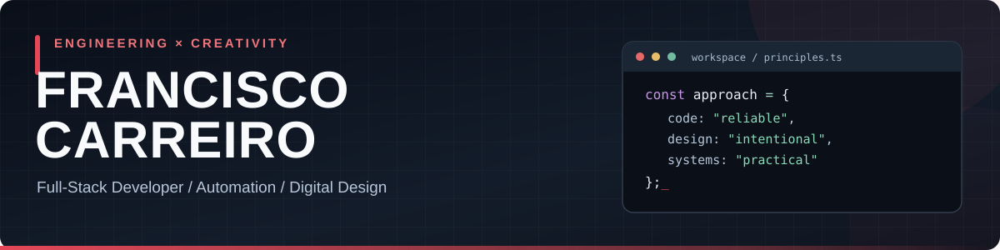

 

**Building useful software where engineering, design, and automation meet.**

---

### About me

I'm **Francisco Carreiro**, a developer and digital creator interested in the space between **full-stack applications, practical tooling, infrastructure, and visual design**.

I like making things that solve real problems, whether that's a web application, a Windows utility, a workflow that saves time, or a carefully crafted interface. I care about maintainable code, thoughtful UX, and having control over the tools I run.

- **Build:** web experiences, developer tools, and desktop utilities
- **Automate:** workflows, repetitive tasks, and system maintenance
- **Explore:** AI-assisted software, local-first systems, and creative interfaces
- **Create:** visual identity, UI/UX, interactive experiences, and games

### ⚓ From the shipyard

  <picture>
    <source media="(max-width: 640px)" srcset="assets/salty-siren-terminal-mobile.svg" />
    
  </picture>

Original, self-hosted ASCII art in SVG. No JavaScript, tracking, remote generators, or live-data claims. Respects reduced-motion settings.

### Selected projects

<table>
  <tr>
    <td width="50%" valign="top">
      <h3>⚔️ <a href="https://github.com/francisco-carreiro/mimir-forge">MÍMIR FORGE</a></h3>
      
Portable Windows 11 toolbox for diagnostics, security inspection, guided repairs, and opt-in system preferences. Built around visibility, reversibility, and user control.

      
<a href="https://github.com/francisco-carreiro/mimir-forge">Explore the project →</a>

    </td>
    <td width="50%" valign="top">
      <h3>✿ <a href="https://github.com/francisco-carreiro/aniimo-center">Aniimo Wildbook</a></h3>
      
Mobile-friendly companion and installable PWA for exploring Aniimo, comparing forms, planning teams, and tracking a personal collection.

      
<a href="https://aniimo-center.netlify.app/">Open the app →</a>

    </td>
  </tr>
  <tr>
    <td width="50%" valign="top">
      <h3>🧼 <a href="https://github.com/francisco-carreiro/background-remover">Background Remover</a></h3>
      
Python desktop application for AI-assisted image background removal, batch processing, previews, and optional watermarking.

      
<a href="https://github.com/francisco-carreiro/background-remover">Explore the project →</a>

    </td>
    <td width="50%" valign="top">
      <h3>🌐 <a href="https://github.com/francisco-carreiro/portfolio">Portfolio</a></h3>
      
A personal portfolio project showcasing web development and visual presentation. Also take a look at my current digital portfolio.

      
<a href="https://fc-digital-architect.netlify.app/">Visit my portfolio →</a>

    </td>
  </tr>
</table>

### What I work with

**Web & application development**

**Tools, systems & delivery**

**Design & creative work**

### Beyond the code

Music, art, games, and nature help shape the way I think about software. I enjoy projects that balance the technical details with the experience of the person using them.

---

**Have a project in mind or want to connect?**

[Portfolio](https://fc-digital-architect.netlify.app/) · [LinkedIn](https://www.linkedin.com/in/francisco-carreiro/) · [GitHub projects](https://github.com/francisco-carreiro?tab=repositories)

Thoughtfully built. Continuously improved.

